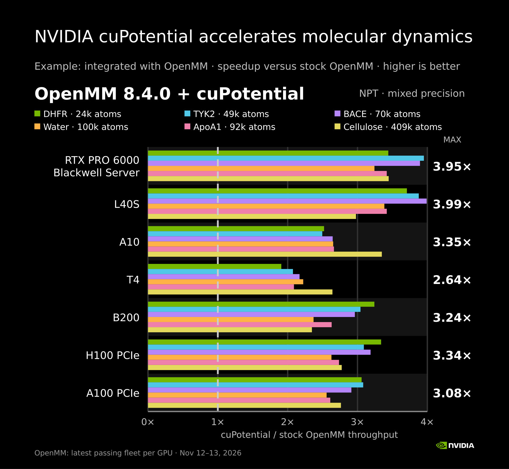

  

# NVIDIA cuPotential

cuPotential is a CUDA-X library for efficient computation of molecular interactions
found in standard forcefields for molecular dynamics. Its OpenMM plugin provides
nonbonded forces, an integrator, and a barostat backed by the cuPotential runtime.

**[cuPotential documentation](https://docs.nvidia.com/cuda/cupotential)** contains
installation instructions, examples, API guides, theory, and benchmarks.

- [Installation](https://docs.nvidia.com/cuda/cupotential/install)
- [OpenMM NonbondedForce: standard and custom interactions](https://docs.nvidia.com/cuda/cupotential/nonbonded-force)
- [C API (Experimental)](https://docs.nvidia.com/cuda/cupotential/c-api/getting-started)
- [Releases](https://github.com/NVIDIA/cuPotential/releases)

cuPotential is in early-access mode. Its C API is experimental: expect breaking
changes, including to its structure, in upcoming releases.

## Licensing

See [LICENSE](LICENSE) for the component licensing overview and links to the
full license texts.
